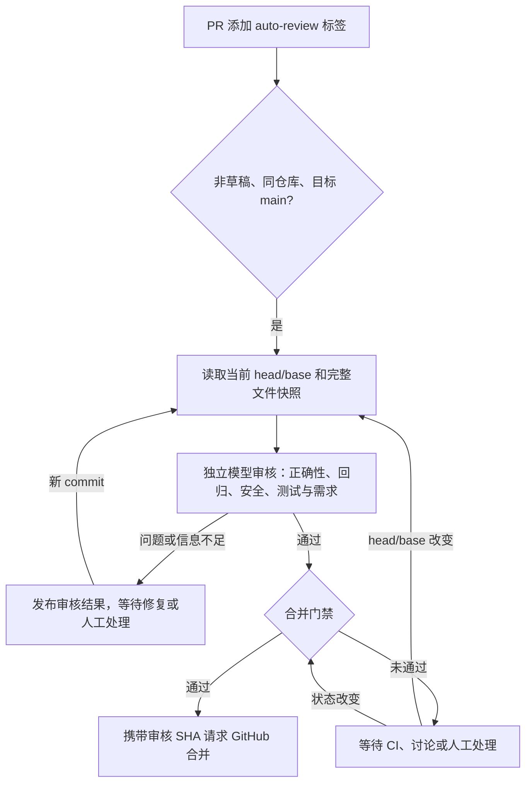

# PR 自动审核与合并

这是独立的 DSH Host 插件，复用当前 Superagent 的 GitHub 身份和模型配置。默认每 60 秒检查一次配置仓库，只有目标为 `main`、非草稿、来自同一仓库且带 `auto-review` 标签的 PR 才进入流程。当前部署配置针对 OpenBot，已启用自动合并；插件 Config 的通用默认值为关闭自动合并。



## 使用

在 OpenBot PR 的 Labels 中添加 `auto-review`。这同时表示允许插件审核，并在全部门禁通过后合并。移除标签或转为 Draft 可退出流程；正在运行的模型调用结束后会重新检查范围，合并前也会重新检查。已提交给 GitHub 的合并请求无法用移除标签撤回。

审核结果以机器人账号的 GitHub **COMMENT review** 发布，并标记 head、base 和策略版本。不会伪造 APPROVED，不会替代仓库要求的人工 approval，也不会自动修改 PR 代码。发现问题时，作者或现有 Superagent worker 修复并推送新 commit 后，插件重新审核。

同一个 head/base/策略只审核一次；等待 CI 时复用记录。base 更新同样需要重新审核。记录先落盘再发布，发布失败可重试，并通过机器人身份和版本标记避免重复 review。

## 合并门禁

所有条件必须同时满足：

- `autoMerge` 已开启，PR 仍带标签、非草稿、来自同一仓库，且目标为配置分支。
- 当前 head 和 base 均与已通过并成功发布的审核一致，审核完整、没有 finding，也没有人工确认要求。
- 改动严格小于 `maxChangedLines`，当前为 500 行（additions + deletions）。
- `github` / `both` 模式下，所有 GitHub Check Suites、各 suite 的最新 Check Runs 和 commit statuses 均成功，且至少有一项 CI；失败、重跑中、skipped、neutral、cancelled、timed_out 等均不放行。分页核对 total_count 和 suite 检查数量，不使用被截断的结果。`local` / `both` 模式还要求配置中的每个 job/matrix task 产生完整的成功证据并完成资源清理。
- 没有未解决的 review thread，没有仍然有效的 CHANGES_REQUESTED，GitHub reviewDecision 不能是 REVIEW_REQUIRED / CHANGES_REQUESTED。
- PR head 已包含当前 base commit，GitHub `mergeable=true`。`github` / `both` 模式要求 `mergeable_state=clean`；`local` 模式接受 `clean` 或 `unstable`，仍须全部本地 CI 通过并由 GitHub 服务端执行分支保护。已有其他流程开启 GitHub auto-merge 时暂停，避免多个流程并行合并。
- 高风险文件转人工：权限/安全、依赖及锁文件、迁移、部署、GitHub workflows、环境变量和凭据等；重命名前后的路径均检查。界面文件也由人工确认视觉结果并合并，以保留当前部署的 UI 审核约束。路径检查仅为补充，模型也须识别语义风险。
- 当前 Superagent 正常、未暂停、GitHub 来源启用、仍监听同一仓库且使用同一个机器人账号。

合并使用 REST `PUT /repos/{owner}/{repo}/pulls/{number}/merge`，绑定审核的 `sha`，默认 merge commit。GitHub 在服务器继续执行分支保护；不使用 admin bypass、不修改保护规则、不启用 GitHub 的延迟 auto-merge。仓库关闭 GitHub 内置 auto-merge 不影响这种已通过门禁后的直接合并。

标签、CI、review、base 与合并并非 GitHub 的单个原子事务。插件尽量在请求前复查；SHA 参数原子保护 head。若需要服务器原子保证 required checks、禁止 base 落后、approval 和 CODEOWNERS，应由管理员设置分支保护 / ruleset。目前机器人只有写权限，无法确认或配置所有保护规则；插件不会把无法读取的保护配置解释为不存在。

## 本地 act CI

OpenBot 配置使用 `ciMode: local`，本地只运行 `.github/workflows/ci.yml` 的 `static`、`deployables`（两个静态矩阵组合）、`test`（含 PostgreSQL 服务）和 `build`，共五个 job/matrix task。平台专属、部署、镜像发布、E2E/browser 等 jobs 不在本地集合中。每次运行读取 PR base SHA 上的 workflow，按 PR head SHA 建立干净 detached checkout，不复制源目录未提交文件。

本地门禁使用受控构建的 act `0.2.97-dsh2`。`build-isolated-act.sh` 从固定上游 commit 应用两处小 patch，确保 job 容器与服务使用同一私有网络，并为每个 job/matrix task 使用随机 nonce 命名的 `/opt/hostedtoolcache` 卷；执行后必须验证并清理该卷、带 nonce 的容器/网络、临时 action cache 和 checkout。普通上游 act 会共享可写 `act-toolcache`，插件启动时会拒绝该二进制。runner 镜像以 sha256 固定；job 容器不挂 Docker socket，不注入 Harness、GitHub CLI 或云服务凭据，不发布 service host ports；服务只经 job 内 loopback TCP forwarder 访问。服务转发的端口须与 base workflow 声明的静态映射一致，配置不匹配会在执行前被拒绝。临时 Git checkout 保持 detached，并保留指向目标 SHA 的本地引用，确保文件复制后仍能执行 Git 和子模块命令。日志保存在 `stateDir/ci/pr-<number>-<nonce>/`，文件权限为 0600。

`ciMode: github` 只要求 GitHub 检查；`local` 只要求配置中的全部本地 job/matrix 通过；`both` 要求二者都通过。`dsh/act` status 只用于可见状态，不算作独立 GitHub CI。GitHub 分支保护仍由服务器在 REST merge 时执行；本地 act 结果不能绕过 required checks、approval、base 或权限限制。act 不完全实现 GitHub Actions（如 job permission、OIDC、concurrency 等）；本地 job 集合只提供额外的自动化证据，测试结果仍须按风险和范围解释。

重新构建并验证指定 act 和 runner：

```sh
./plugins/pr-automation/build-isolated-act.sh
```

如果上游版本或 runner image 改变，先检查本地 CI 计划和 image diff，再更新 `localCi.runnerImage` 的 sha256；禁止在插件启动时静默改用 tag。

## 状态与暂停

在 Harness **插件管理器 → PR 自动审核与合并** 中配置或停用。停用会取消正在运行的模型请求、停止后续轮询并释放状态锁。Superagent 的暂停开关也会暂停此插件启动新任务和提交 review / merge。

当前部署还通过管理 API 将 Superagent 的 delivery 提示词保存为 revision 3：worker 不再自行合并或启用 GitHub auto-merge；没有标签的 PR 留给人工合并，worker 只有收到人明确要求时才能添加标签。推送或重写已加入流程的 PR 前，worker 须暂时移除标签，验证新版本后仅在原授权仍有效时恢复。新 commit（包括仅重写提交信息）必须重新审核。其他团队提示词保持原值；原 revision 2 的备份保存在审核状态目录内的 `superagent-prompts-before-integration.json`。这项 worker 行为约束属于提示词，不是对 danger-full-access worker 的 OS 权限隔离；插件自身的门禁由代码执行。

本地只读状态接口：

```sh
curl -fsS -H 'x-pr-automation-request: 1' \
  http://127.0.0.1:3200/pr-automation/api/status
```

返回监听仓库、标签、模型、自动合并开关、最后轮询时间和各 PR 的 `reviewing`、`changes_requested`、`manual`、`waiting`、`merged` 或 `error` 状态及阻塞原因。接口只允许本机 Host、同源请求及 GET，要求上面的专用请求头。

审核记录位于配置的 `stateDir/reviews.json`，包含模型、耗时、结果、发布 review id 和合并 commit。目录默认权限 0700，记录默认 0600，采用临时文件加原子重命名写入；通过 proper-lockfile 的目录锁和心跳限制同一目录只运行一个实例，锁失效时停止后续发布与合并。目录在本仓库忽略的 `.artifacts/` 下，包含代码审核内容，应按本地工程资料保管。

插件进程与当前 Harness 共存，Harness 停止后不会继续处理 PR；安装保存在当前 profile，重启后会重新启动。无需 GitHub Actions secret 或新增模型凭据。

## 安装与配置

通过 Harness 的 `plugin_manager install_bundle` 安装本目录。不要手写 profile 的包文件或 patch。部署专用参数在本包的 `cordis.patch.yml` 中，安装后的配置可在插件管理器调整。

主要参数：

| 参数 | 当前设置 / 含义 |
| --- | --- |
| `repository` | 从现有 GitHub Source 读取的 OpenBot 仓库 |
| `cli` | 现有专用 `gh-agent` 包装命令 |
| `label` | `auto-review` |
| `autoMerge` | `true`；关闭后只审核、记录并等待 |
| `baseBranch` | `main` |
| `mergeMethod` | `merge`；支持 `squash` / `rebase` |
| `pollSeconds` | 60 |
| `maxChangedLines` | 500，不含该值 |
| `maxContextChars` | 180000；最多 40 个文件；无法完整读取则转人工 |
| `provider` / `model` | 当前部署评估模型 `magpie` / `group/cc-stable` |
| `reasoningEffort` | `high` |
| `superagentOrigin` | 现有 `http://127.0.0.1:3200` |
| `stateDir` | 本机审核记录及锁的绝对目录 |

完整 changed-file before/after、patch、PR 说明及 base 版本的根/祖先 AGENTS.md、README.md、package.json 会送到配置模型。模型没有工具，不会执行 PR 里的代码或指令。缺少必要的未修改调用方、测试或规格时须转人工；模型审核本身是静态分析；项目测试由配置的 GitHub CI 或本地 act 后端执行。模型结论有局限，人工审核和服务器分支保护仍适用于需要它们的改动。

## 验证结果

本次安装、线上只读检查、测试结果和未覆盖的验证范围见 [VERIFICATION.md](VERIFICATION.md)。

本机 `GET /pr-automation/api/status`（请求头 `x-pr-automation-request: 1`）提供运行状态。最新版的 `ciRuntime` 包含实现版本、act 版本、镜像 SHA 和 CI 配置指纹；当前实现版本为 2，要求 act `0.2.97-dsh2`。安装器返回 `restart-required` 时须重启现有 DSH，再核对这些字段及 `phase: ready`；仅看到配置指纹更新不能证明执行代码已重载。

## 本地验证

```sh
cd plugins/pr-automation
node --test tests/*.node.js
```

覆盖启用范围、CI 缺失/失败/跳过、审核讨论、旧 head/base、策略版本、读取中更新、撤销标签、暂停、发布失败、分页、重复轮询、模型截断以及携带 SHA 合并等情形。测试使用模拟 GitHub 和模型，不会创建或合并真实 PR。

图标为本项目原创 SVG，随本包以 MIT 许可分发。
